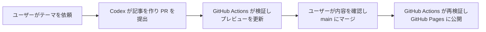

# AI SIGNAL ハーネス構造

AI SIGNAL では、Codex が記事を作り、GitHub Actions が形式を検証し、ユーザーが内容を確認して公開を承認します。この役割分担を支える制作ルール、記事ファイル、検証・公開の設定を、このリポジトリではハーネスと呼びます。

## 記事が公開されるまで



1. **制作** — Codex はスキルの使用を明示し、[AGENTS.md](../AGENTS.md) から [create-ai-news の制作手順](../.agents/skills/create-ai-news/SKILL.md) をたどり、出典を確認して本文と要約画像を作ります。日付などの広いテーマでは、複数のニュースを一つの記事にまとめます。同じ本文と確認済みの出典を使い、3人のコメントスキルで視点と語り口の異なるコメントを作ります。
2. **レビュー用 PR** — Codex は記事フォルダを記事専用ブランチにコミットし、GitHub API で PR を作ります。PR には出典、制作内容、検証状況、プレビュー URL を載せます。記事制作時の自動検証は PR の GitHub Actions で実行します。
3. **プレビュー** — PR の検証が成功すると、GitHub Actions が Pages の更新を起動します。同じリポジトリ内の PR は `/previews/pr-<PR番号>/` で誰でも閲覧できます。外部フォークの PR では検証を実行します。PR を閉じると次の Pages 更新でプレビューが削除されます。
4. **公開** — ユーザーが PR とプレビューで内容を確認し、自分で `main` にマージすると公開承認になります。`main` の更新後、GitHub Actions が検証とビルドを実行し、成功した成果物を GitHub Pages にデプロイします。記事の追加・削除はサイトの一覧、詳細ページ、画像に反映されます。

記事制作以外の変更は、別途指定がなければ、対象だけをコミットしてリモートの状態を確認し、`main` に直接プッシュします。プッシュ後は Actions の結果を確認し、未完了や失敗を報告します。PR の作成手順と公開後の確認項目は [記事の確認と公開](publishing.md) を参照してください。

## どこを見ればよいか

| 知りたいこと | 参照先 | 役割 |
| --- | --- | --- |
| Codex の作業ルール | [AGENTS.md](../AGENTS.md) | 作業前の Git 確認、記事制作と通常変更の進め方を定める |
| 記事の制作手順と基準 | [create-ai-news](../.agents/skills/create-ai-news/SKILL.md)、[入力テンプレート](../.agents/skills/create-ai-news/references/input-template.md)、[編集基準](../.agents/skills/create-ai-news/references/editorial.md)、[記事仕様](../.agents/skills/create-ai-news/references/article-format.md) | テーマの受け取りから調査、執筆、画像・コメント制作、レビュー用 PR の提出までを定める |
| 3人のコメントの作り方 | [黒瀬 修司（辛口評論家）](../.agents/skills/news-comment-critic/SKILL.md)、[水野 結衣（専門家）](../.agents/skills/news-comment-expert/SKILL.md)、[田辺 悠人（一般読者）](../.agents/skills/news-comment-reader/SKILL.md) | 架空の人物ごとに、コメントの視点と語り口を定める |
| サイトに表示する人物情報 | 各コメントスキルの `profile.ts` と `assets/portrait.png`、[commentators.ts](../src/data/commentators.ts) | スキルごとに表示用のプロフィールと顔画像を持ち、サイト側で3人のプロフィールを読み込む |
| 記事の保存場所 | [src/content/articles/](../src/content/articles/)、[制作ログの記録基準](../article-logs/README.md) | 記事ごとに本文・画像・制作ログを同じフォルダに置く |
| 記事データからサイトを作る処理 | [content.config.ts](../src/content.config.ts)、[src/pages/](../src/pages/) | Astro が記事のメタデータを読み込み、ビルド時に一覧・詳細ページ・画像を出力する |
| PR の確認項目と公開の設定 | [PR テンプレート](../.github/pull_request_template.md)、[ci.yml](../.github/workflows/ci.yml) | PR の確認項目を示し、検証・プレビュー更新・本番デプロイを単一のワークフローで実行する |

記事フォルダは次の3ファイルで構成します。

```text
src/content/articles/<slug>/
├── article.md  本文・メタデータ・出典・3人のコメント
├── image.png   要約画像（jpg / jpeg / webp も可）
└── log.md      調査・制作・検証の履歴
```

制作ログは PR と公開リポジトリで読めます。GitHub Pages の記事詳細ページには本文・出典・コメント・要約画像が表示されます。

## 自動検証とレビューで確認すること

| 担当 | 確認すること |
| --- | --- |
| GitHub Actions | `npm run check` で Astro の型と記事メタデータを確認し、[記事検証スクリプト](../scripts/validate-articles.mjs) で本文・画像・制作ログがそろっているかを確かめる。ビルドでプレビュー用 URL を確認し、[記事追加・削除のテスト](../scripts/test-article-lifecycle.mjs) で一覧・詳細ページ・画像への反映を検証する |
| Codex とユーザー | 出典が本文の主張を裏付けるか、画像が内容に合っているか、コメントが妥当かを、制作時と PR レビューで確認する |

ローカルでサイトを開発・検証する手順は [開発と検証](development.md) を参照してください。

## このページを更新するタイミング

スキル、記事の保存形式、人物情報、検証、PR・公開の流れを変えたときは、該当する変更と同時にこのページを更新します。図と参照先が実際の手順や設定に合っているか確認してください。
