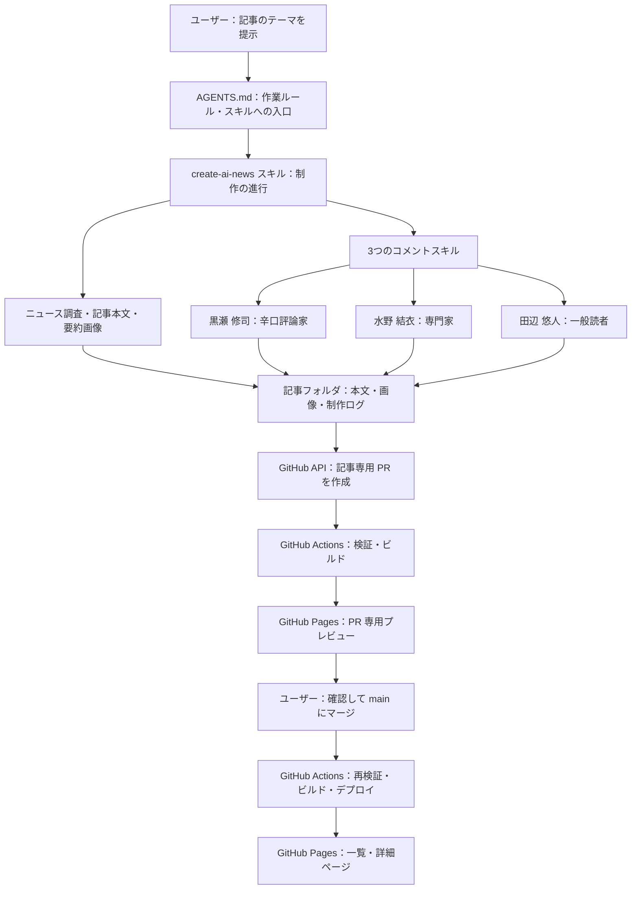

# AI SIGNAL ハーネス構造

AI SIGNAL のハーネスは、Codex が記事を制作するときの指示、素材、検証、人による承認、公開をつなぐ仕組みです。各ファイルの役割と、記事が公開されるまでの経路をこのページで確認できます。

## 記事制作から公開まで



PR プレビューは公開 URL（/previews/pr-<PR番号>/）として配信し、PR が閉じた後の更新で削除します。プレビューも誰でも閲覧できます。

Codex は記事制作時に `create-ai-news` と3人のコメントスキルを明示して使用します。PR のマージが記事の公開承認です。記事制作以外の変更では、別途指定がなければ PR を作成しません。

記事以外の変更は、別途指定がない限り、対象の変更をコミットし、リモートの状態を確認して `main` にプッシュします。プッシュ後に GitHub Actions の状態を確認し、未完了や失敗を報告します。既存の無関係な変更は含めません。

日付などの広いテーマでは、複数のニュースを選んで一つの記事にまとめます。ニュース媒体や解説記事を含む有用な出典を確認し、3人はそれぞれ異なる視点と語り口でコメントします。

記事 PR は Git の既存認証情報を使って GitHub API から作成し、取得した番号を使って本文にプレビュー URL を追記します。詳細は `docs/publishing.md` を参照してください。

## ファイルと役割

```text
AGENTS.md                               # 全体ルールと参照先
.agents/skills/
├── create-ai-news/
│   ├── SKILL.md                        # 記事制作の手順
│   └── references/
│       ├── input-template.md           # テーマなどの入力テンプレート
│       ├── editorial.md                # 調査・執筆の基準
│       └── article-format.md           # 記事フォルダとデータ形式
├── news-comment-critic/                # 黒瀬 修司
├── news-comment-expert/                # 水野 結衣
└── news-comment-reader/                # 田辺 悠人
    ├── SKILL.md                        # 人物設定・コメント生成の指示
    ├── profile.ts                      # サイト表示用プロフィール
    └── assets/portrait.png             # 顔画像（各人物のフォルダに配置）

src/content/articles/<slug>/
├── article.md                          # 本文・出典・3人のコメント
├── image.png                           # 要約画像（jpg / webp も可）
└── log.md                              # 調査・制作・検証の履歴
article-logs/README.md                  # 制作ログの記録基準
src/content.config.ts                   # 記事メタデータのスキーマ
scripts/validate-articles.mjs           # 記事フォルダ・画像・ログの検証
scripts/test-article-lifecycle.mjs      # 記事追加・削除後の出力を検証
src/data/commentators.ts                # 各スキルのプロフィールを集約
src/pages/                              # ニュース一覧・詳細・画像の出力
.github/workflows/ci.yml                # PR と main の検証・プレビュー・公開
.github/workflows/deploy.yml            # main の公開
.github/pull_request_template.md        # PR の確認項目
docs/development.md                     # 開発・検証の手順
docs/publishing.md                      # 記事の確認・公開の手順
```

記事一覧はビルド時に記事フォルダから生成されます。追加・削除を含む記事 PR を main にマージすると、公開サイトの一覧・詳細ページ・画像にも反映されます。

記事フォルダの `log.md` は PR と公開リポジトリで確認できますが、サイトのページとしては出力されません。コメントスキル配下の人物情報は架空の設定です。

## 検証と確認の役割分担

- `npm run check` は Astro の型・記事メタデータ、記事フォルダの本文・画像・ログの存在を確認します。`npm run build` は静的サイトを生成します。
- PR と main 更新時には単一ワークフローが検証・ビルドし、テスト用記事の追加・削除も確認します。main 更新時は検証成功後に公開し、PR 時は成功後に Pages のプレビュー更新を別途起動します。
- 出典の正確さ、画像の内容、コメントの妥当性は自動チェックだけでは保証できません。Codex が制作時に確認し、ユーザーが PR でレビューします。
- 記事制作ではローカルのチェック・ビルドを実行せず、PR の GitHub Actions の結果と未検証事項を確認します。

## このドキュメントの更新

スキル、記事の保存形式、人物情報、検証、PR・デプロイなど、ここに記載した構造や流れが変わったときは、該当する変更と同時にこのページを更新してください。図、ファイルの役割、検証の説明が実装と一致しているか確認します。記事内容の追加だけで構造が変わらない場合、更新は不要です。
